# CtPassStore user guide

CtPassStore gives everyone in your ChurchTools a **secondary password**: a password of its own for connected services
such as the Wi-Fi, independent of the ChurchTools password. You open it in ChurchTools under „CtPassStore“ (your
congregation may have named the card differently).

This guide describes the extension version it belongs to; the „Über“ page links to the guide of exactly your version.
The screen texts are quoted in German; with ChurchTools set to English the extension shows them in English.

**Versions:** Install backend and extension with the same first two version numbers. (Extension `0.1.x` works with
backend `0.1.x`; the third number may differ.) If they don't match, the extension says so and shows both versions.

## Mein Passwort (everyone)

The card shows whether you have a password („✓ Passwort ist gesetzt“ or „Noch kein Passwort“). For security reasons
the password itself is never shown again; if you forgot it, simply set a new one.

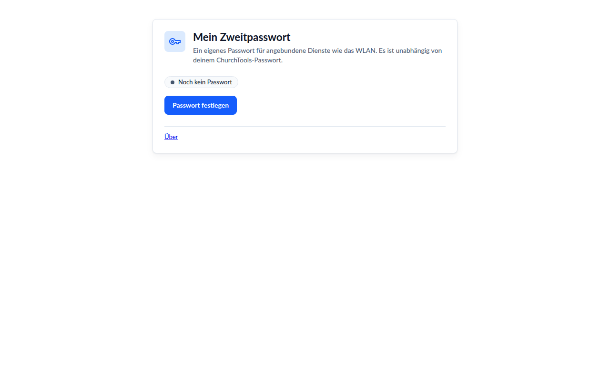

1. Click **„Neues Passwort festlegen“** (or „Passwort festlegen“ the first time). Your old password stops working once
   the new one is saved.
2. Choose how the new password comes about:
   - **„Zufällig erzeugen“** (recommended): the extension creates a strong password for you.
   - **„Selbst wählen“** (only if your congregation allows it): type your own. The list below the field ticks off the
     rules as you type: the minimum length (at least 12 characters), at least one letter, one digit and one special
     character of `! @ $ % & * - _ + = ? .`, and no other characters (no umlauts, no spaces).
3. If asked, type your **ChurchTools password** to confirm that it's you.
4. A generated password is shown **once**. Copy it with the icon inside the field („✓ Kopiert“), store it in your
   password manager or write it down, then click **„Fertig“**. After that it can't be shown again.

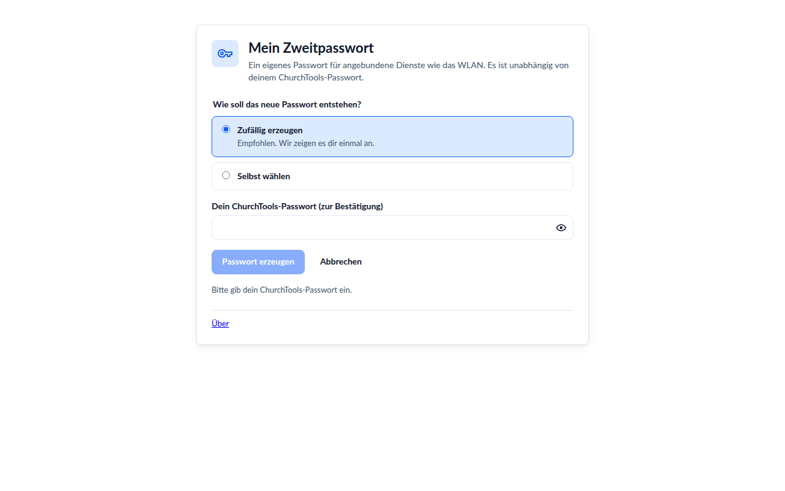
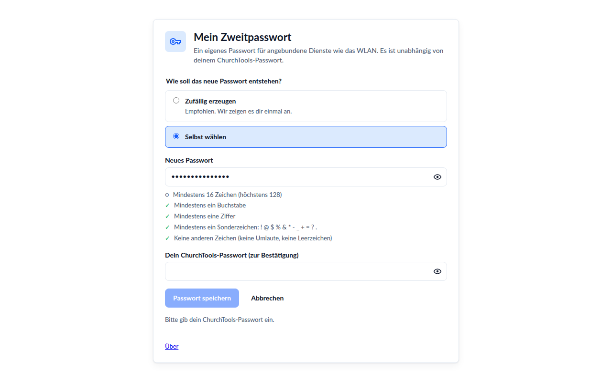
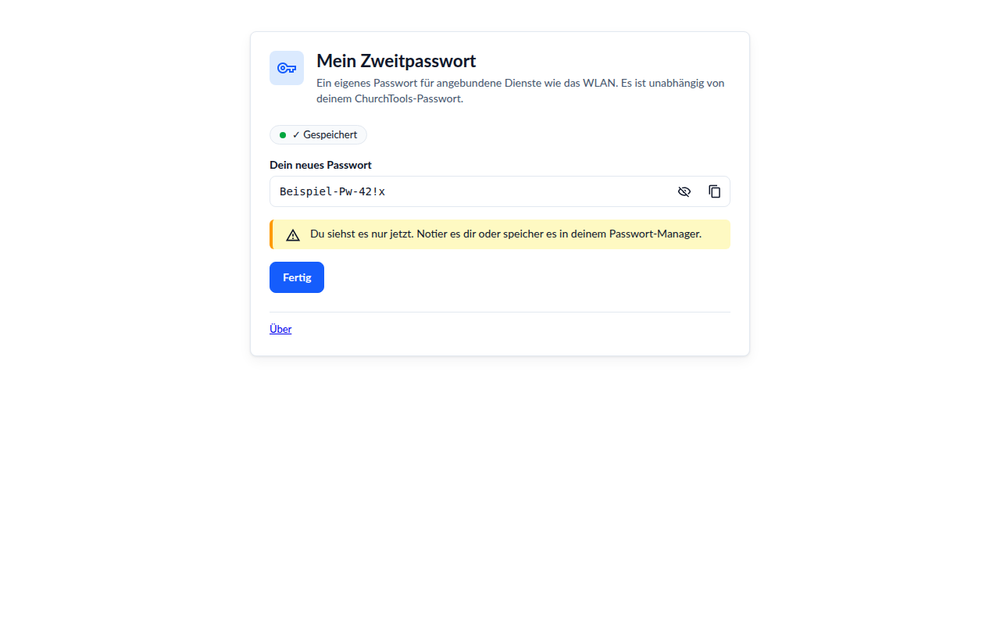

If your session ran out while you were typing, a banner „Deine Sitzung ist abgelaufen“ appears with a button to renew
it; what you typed is kept.

## Passwörter verwalten (admins)

Admins are the members of the admin group in ChurchTools. They see a sidebar with „Mein Passwort“, „Passwörter
verwalten“, „Einstellungen“ and „Über“.

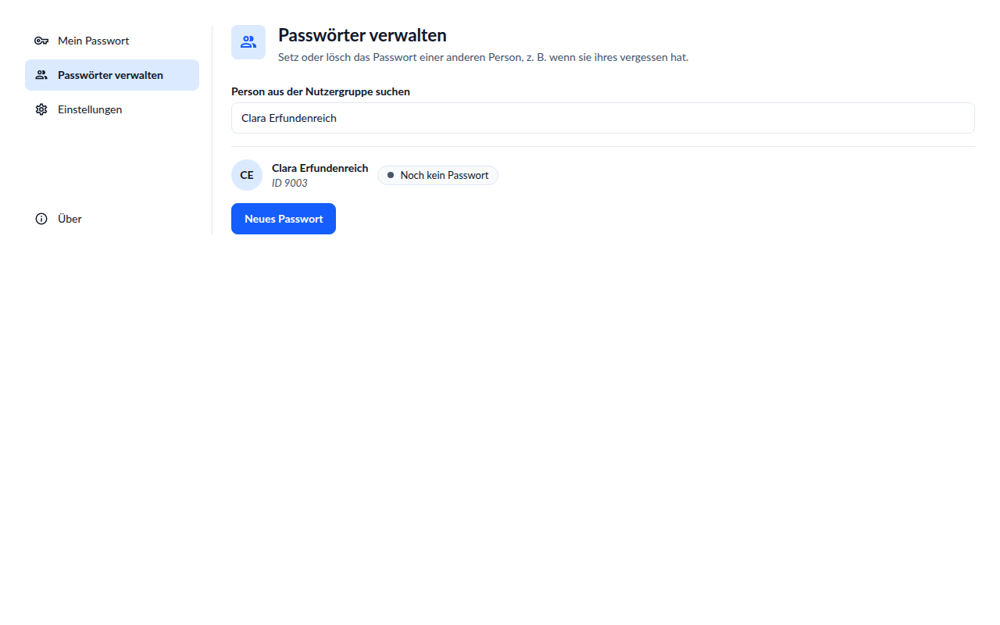

- Search a person by name, or by their ChurchTools ID (shown small under every name, so two people with the same name
  can be told apart). Only members of the users group are found.
- **„Neues Passwort“** sets a new password for that person, the same way as on „Mein Passwort“. A yellow banner names
  the person, and if they already have a password, a dialog asks before replacing it. If a ChurchTools password is
  asked for, it is **your own**.
- **„Löschen“** deletes the person's password after a confirmation.

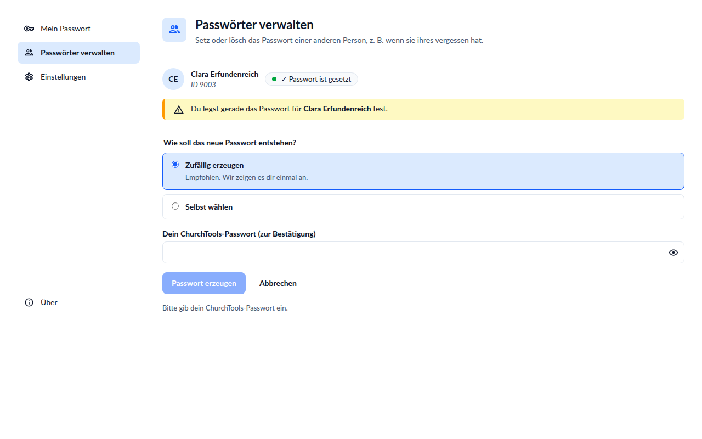
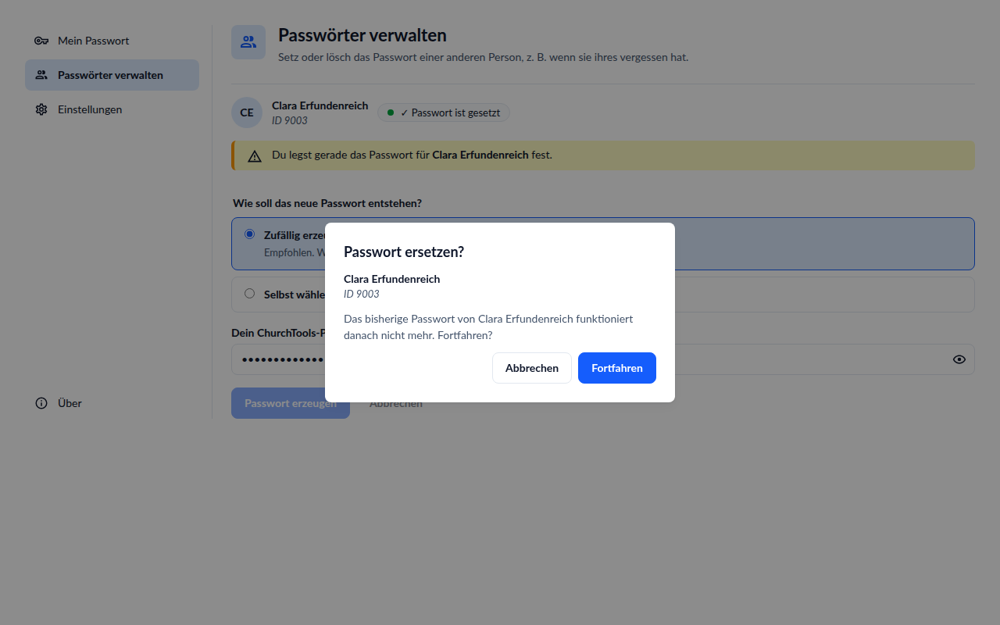

## Einstellungen (admins and settings editors)

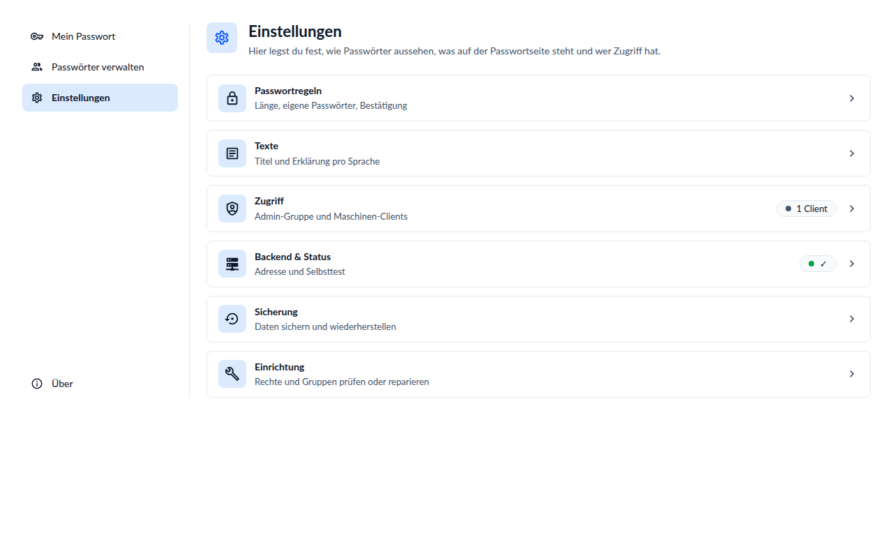

- **Passwortregeln:** whether the ChurchTools password is asked for before a change, whether people may choose their
  own password, and the password length (12 to 64; generated passwords have exactly this length, chosen ones at least
  this length). Existing passwords keep working when the rules change.
- **Texte:** title and explanation of the password card, per language. An empty field means the default text.
- **Zugriff:** the users group and the admin group (members are managed in ChurchTools) and the machine clients, such
  as a ct-radius server, that may read passwords. Whoever can change things here has access to all passwords: keep
  this circle very small.
- **Backend & Status:** the address of the backend, its version and a self-test.
- **Sicherung** and **Einrichtung** come with the setup assistant.

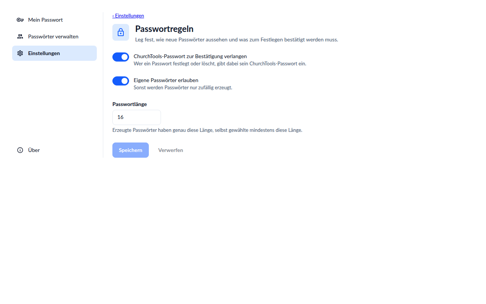
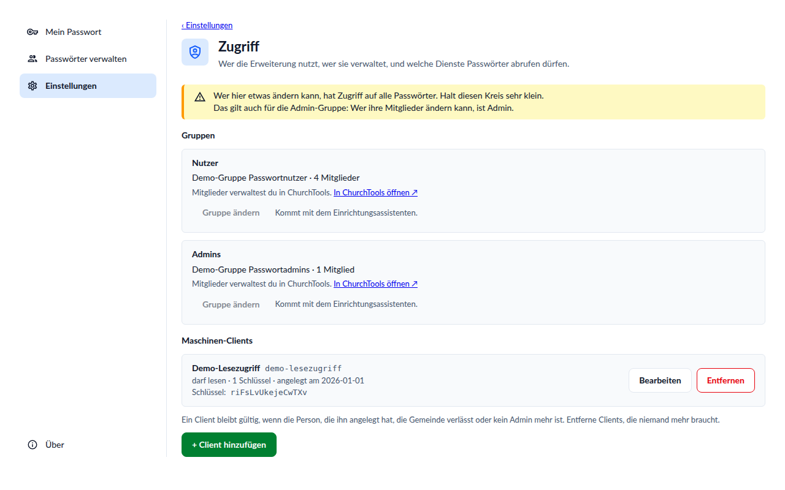

Every settings page saves only on „Speichern“ and asks before you leave it with unsaved changes. If someone else
changed the settings in the meantime, the page tells you instead of overwriting their change.

### Who must be trusted: the admin group

**Whoever can change the backend address can obtain the ChurchTools passwords of your users.** Users type their
ChurchTools password into the extension to confirm a change (if the settings ask for it), and the extension sends it,
and every new secondary password, to the backend at that address. Someone who changes the address to a server of their
own receives those passwords from then on, and users see no difference.

The backend address can be changed by the admin group, and by everyone who controls who is in that group. So the
admin group, and everyone who can change its members, must be **as trustworthy as your ChurchTools administrators**.
Keep it small, and don't give anyone the right to change its members who isn't trusted that much.

„Backend & Status“ warns about exactly this as soon as the address field differs from the stored address, and saving
asks again in a dialog naming the old and the new address. Normal users are not asked: they couldn't judge it. The
new address takes effect when the page is loaded again.

## On a phone

The extension works in a phone's browser:

- Everything is one column, buttons take the full width, and fields use a large enough font that the phone doesn't
  zoom in.
- Admins find the pages in a menu at the top instead of the sidebar.
- The copy icon in the password field copies the generated password, ready to paste into your password manager.

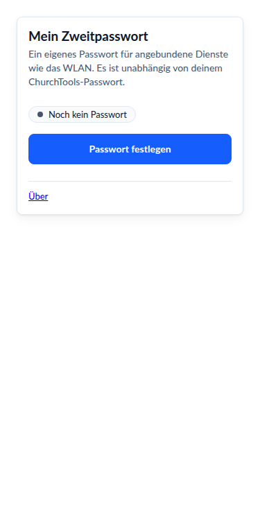
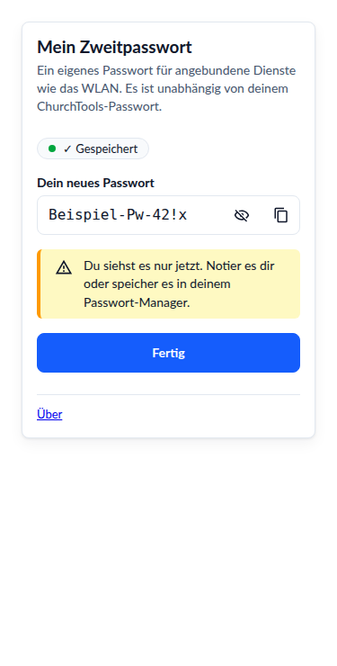
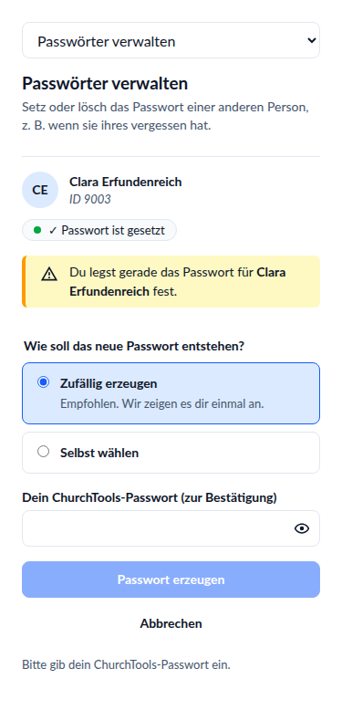
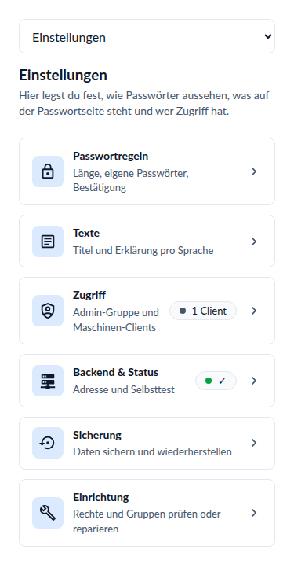

## Über

The „Über“ page (a small link in the card's footer, or in the admin sidebar) shows the versions of the extension and
the backend, and links to this guide and the release notes of your version.

## If something doesn't work

- **„Du hast keinen Zugriff auf diese Erweiterung“:** you don't have the right to use it (usually: you aren't in the
  users group); ask the people responsible in your congregation.
- **„Die Erweiterung wird gerade eingerichtet“:** the extension is being set up or updated; try again later.
- **„Der Dienst ist gerade nicht erreichbar“:** the backend can't be reached; try again later. Admins find details on
  „Backend & Status“.
- **The versions don't match:** backend and extension need the same first two version numbers (see above); the
  admins update the one that is behind.
